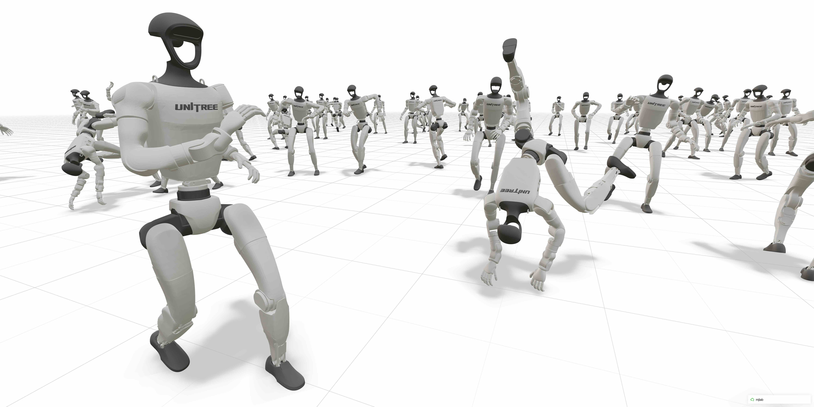

# mjlab

[](https://github.com/mujocolab/mjlab/actions/workflows/ci.yml?query=branch%3Amain)
[](https://mujocolab.github.io/mjlab/)
[](https://github.com/mujocolab/mjlab/blob/main/LICENSE)
[](https://mujocolab.github.io/mjlab/nightly/)
[](https://pypi.org/project/mjlab/)

mjlab 将 [Isaac Lab](https://github.com/isaac-sim/IsaacLab) 的 manager-based API 与
[MuJoCo Warp](https://github.com/google-deepmind/mujoco_warp)（MuJoCo 的 GPU 加速版本）相结合。
该框架提供可组合的环境设计构建模块，依赖极少，并可直接访问 MuJoCo 原生数据结构。

## 快速上手

训练需要 NVIDIA GPU；macOS 仅支持评估。

**立即体验**（无需安装）：

```bash
uvx --from mjlab --refresh demo
```

或在 [Google Colab](https://colab.research.google.com/github/mujocolab/mjlab/blob/main/notebooks/demo.ipynb) 中尝试（无需本地环境）。

**从源码安装：**

```bash
git clone https://github.com/mujocolab/mjlab.git && cd mjlab
uv run demo
```

其他安装方式（PyPI、Docker）见[安装指南](https://mujocolab.github.io/mjlab/source/installation.html)。

## 训练示例

### 1. 速度跟踪

在平地上训练 Unitree G1 人形机器人跟踪速度指令：

```bash
uv run train Mjlab-Velocity-Flat-Unitree-G1 --env.scene.num-envs 4096
```

**多 GPU 训练：** 使用 `--gpu-ids` 扩展到多块 GPU：

```bash
uv run train Mjlab-Velocity-Flat-Unitree-G1 \
  --gpu-ids 0 1 \
  --env.scene.num-envs 4096
```

详见[分布式训练指南](https://mujocolab.github.io/mjlab/source/distributed_training.html)。

训练期间评估策略（从 Weights & Biases 拉取最新 checkpoint）：

```bash
uv run play Mjlab-Velocity-Flat-Unitree-G1 --wandb-run-path your-org/mjlab/run-id
```

### 2. 动作模仿

训练人形机器人模仿参考动作。mjlab 使用 WandB 管理动作数据集，
准备工作见[动作预处理文档](https://github.com/HybridRobotics/whole_body_tracking/blob/main/README.md#motion-preprocessing--registry-setup)。

```bash
uv run train Mjlab-Tracking-Flat-Unitree-G1 --registry-name your-org/motions/motion-name --env.scene.num-envs 4096
uv run play Mjlab-Tracking-Flat-Unitree-G1 --wandb-run-path your-org/mjlab/run-id
```

### 3. Go2 动作跟踪（本地 npz）

使用 `motions/` 下的本地动作文件训练 / 播放 Unitree Go2 跟踪任务。
训练默认无头模式（`MUJOCO_GL=egl`），日志与 TensorBoard 事件写入
`logs/rsl_rl/go2_tracking/`。

#### 演示视频

学习到的 Go2 技能（文件位于 [`videos/`](videos/)）。
每行两个视频（50/50），避免 GitHub 播放器把中间列拉宽。

<table width="100%">
  <tr>
    <td width="50%" align="center" valign="top">
      <video src="https://github.com/user-attachments/assets/800a0da9-42c4-4cb2-a20b-dcb2e0fa96f7" controls width="240" height="427"></video>
      <br />后空翻
    </td>
    <td width="50%" align="center" valign="top">
      <video src="https://github.com/user-attachments/assets/39d54ec3-1454-4242-8abe-e9e5388f7281" controls width="240" height="427"></video>
      <br />前空翻
    </td>
  </tr>
  <tr>
    <td width="50%" align="center" valign="top">
      <video src="https://github.com/user-attachments/assets/a7419df5-61e3-4dad-9d27-cb5a811a656c" controls width="240" height="427"></video>
      <br />左侧空翻
    </td>
    <td width="50%" align="center" valign="top">
      <video src="https://github.com/user-attachments/assets/8e613766-5154-401c-acf8-30e16f4333f2" controls width="240" height="427"></video>
      <br />右侧空翻
    </td>
  </tr>
  <tr>
    <td width="50%" align="center" valign="top">
      <video src="https://github.com/user-attachments/assets/e52d7050-4e29-4154-b262-4362de74b10c" controls width="240" height="427"></video>
      <br />原地起跳
    </td>
    <td width="50%" align="center" valign="top">
      <video src="https://github.com/user-attachments/assets/6671fdd5-c6d3-4ec1-9518-9cd5b92cce30" controls width="240" height="427"></video>
      <br />向前跳跃
    </td>
  </tr>
  <tr>
    <td width="50%" align="center" valign="top">
      <video src="https://github.com/user-attachments/assets/a85a9024-c823-4b3a-ad54-ea8cc9d7476c" controls width="240" height="427"></video>
      <br />向后跳跃
    </td>
    <td width="50%"></td>
  </tr>
</table>

**依次训练三个跳远动作**（各 4096 envs、10000 轮迭代）：

```bash
cd /path/to/mjlab-dev-go2-mimic

for motion in \
  go2_longjump_0p0 \
  go2_longjump_0p7 \
  go2_longjump_m0p5
do
  echo "========== Training $motion =========="
  uv run python -m mjlab.scripts.train \
    Mjlab-Tracking-Flat-Unitree-Go2-No-State-Estimation \
    --env.commands.motion.motion-file "$PWD/motions/${motion}.npz" \
    --env.scene.num-envs 4096 \
    --agent.max-iterations 10000 \
    --agent.run-name "$motion"
done
```

若在 actor 观测中保留状态估计，请改用任务 ID
`Mjlab-Tracking-Flat-Unitree-Go2`。

**播放**（自动选取按名称排序的最新 ``model_*.pt``）。
``--keep-randomization True`` 保留训练期随机化并默认 **50 个环境**：

```bash
uv run python -m mjlab.scripts.play \
  Mjlab-Tracking-Flat-Unitree-Go2-No-State-Estimation \
  --motion-file $PWD/motions/go2_longjump_m0p5.npz \
  --keep-randomization True
```

需要时可覆盖环境数量：``--num-envs 16``，或使用辅助命令：

```bash
uv run play-go2-rand --motion-file $PWD/motions/go2_longjump_m0p5.npz
```

显式指定 checkpoint：

```bash

 python -m mjlab.scripts.play \
  Mjlab-Tracking-Flat-Unitree-Go2-No-State-Estimation \
  --motion-file $PWD/motions/go2_longjump_m0p5.npz \
  --checkpoint-file logs/rsl_rl/go2_tracking/<run>/model_10000.pt \
  --keep-randomization True
```

## G1 动作跟踪
**训练**（4096 envs、10000 轮迭代；可循环任意动作）：环境变量必须修改

```bash
conda activate env_isaaclab
cd /home/zju/Downloads/mjlab-dev-go2-mimic
export PYTHONPATH=src
```
```bash
for motion in \
  omnixtreme/g1_motion_long_01\
  omnixtreme/g1_motion_long_06 \
  omnixtreme/g1_motion_long_08 \
  omnixtreme/g1_motion_long_10 \
  omnixtreme/g1_motion_long_13
do
  echo "========== Training $motion =========="
  python -m mjlab.scripts.train \
    Mjlab-Tracking-Flat-Unitree-G1-No-State-Estimation \
    --env.commands.motion.motion-file "$PWD/motions/${motion}.npz" \
    --env.scene.num-envs 4096 \
    --agent.max-iterations 10000 \
    --agent.run-name "$(basename $motion)"
done
```

```bash
python -m mjlab.scripts.play \
  Mjlab-Tracking-Flat-Unitree-G1-No-State-Estimation \
  --motion-file $PWD/motions/chunwan/90_15_stageii_unitree_g1.npz  \
```

显式指定 checkpoint：50 个机器人   --keep-randomization True

```bash
python -m mjlab.scripts.play \
  Mjlab-Tracking-Flat-Unitree-G1-No-State-Estimation \
  --motion-file $PWD/motions/chunwan/90_15_stageii_unitree_g1.npz \
  --keep-randomization True
```

### 后端可视化，服务器中也可以使用
```bash
python -m mjlab.scripts.play \
  Mjlab-Tracking-Flat-Unitree-G1-No-State-Estimation \
  --motion-file $PWD/motions/omnixtreme/g1_motion_long_01.npz \
  --viewer viser
```

### Play 时打印手部触地接触

加 `--print-hand-contact True`（tyro 的 `FlagConversionOff` 要求布尔参数
显式给值）：自动注入手部（腕部三连杆，塑料手碰撞体已删除）
vs 地面的接触传感器，play 中实时打印接触 link 与法向力大小（默认阈值 1 N，
0.5 s 节流，仅看 env 0）：

```bash
 python -m mjlab.scripts.play   Mjlab-Tracking-Flat-Unitree-G1-No-State-Estimation   --motion-file $PWD/motions/omnixtreme/g1_motion_long_01.npz --print-hand-contact True
```

可选参数：`--hand-contact-bodies <regex>`（默认
`(left|right)_wrist_(pitch|roll|yaw)_link`）、`--hand-contact-min-force <N>`。

### G1 Dance 任务（倒地恢复实验入口）

**该任务用于后续倒地恢复（fall-and-get-up）实验**：基于
`tracking_env_cfg_dance.py` 的宽松锚点奖励配置（root_pos 1.0 / root_ori 0.5），
后续将在此任务上叠加放松终止条件、躺倒惩罚等倒地恢复训练改动。
执行器已启用梯形力矩-速度包络（见下节）。当前动作数据仅一个：
`motions/dance1_subject2.npz`。

```bash
conda activate env_isaaclab
cd /home/zju/Downloads/mjlab-dev-go2-mimic
export PYTHONPATH=src
```

**训练**:

```bash
python -m mjlab.scripts.train \
  Mjlab-Tracking-Flat-Unitree-G1-Dance-No-State-Estimation \
  --env.commands.motion.motion-file "$PWD/motions/dance1_subject2.npz" \
  --env.scene.num-envs 4096 \
  --agent.max-iterations 10000 \
  --agent.run-name "dance1_subject2"
```

带状态估计版本用任务 ID `Mjlab-Tracking-Flat-Unitree-G1-Dance`。
日志位于 `logs/rsl_rl/g1_tracking/dance1_subject2/`。

**播放**：

```bash
python -m mjlab.scripts.play \
  Mjlab-Tracking-Flat-Unitree-G1-Dance-No-State-Estimation \
  --motion-file $PWD/motions/dance1_subject2.npz \
  --keep-randomization True
```


#### 域随机化（Go2 与 G1）

跟踪任务继承 `tracking_env_cfg.py` 中的随机化配置；Go2 / G1 的任务配置
仅按机器人调整名称或开关附加项。两机器人共有：间隔速度推扰、启动期
质心 / 体重 / PD 增益 / 编码器偏置 / 足端摩擦随机化，以及动作初始状态
（RSI）姿态 / 速度 / 关节位置范围、actor 观测噪声、执行器延迟（如标注）。

| 随机化项 | 模式 | 数值 / 范围 | Go2 | G1 |
| :--- | :---: | :--- | :---: | :---: |
| 速度推扰 `push_robot` | 间隔 1–3 s | 线速度 ±0.5/±0.5/±0.2 m/s，角速度 ±0.52/±0.52/±0.78 rad/s | ✓ | ✓ |
| 垂直推扰 `push_robot_2`（可选） | 间隔 1–2 s | z 向 0–3 m/s，概率 0.8→0 衰减 | 可选 | 可选 |
| 质心偏移 `base_com` | 启动 | `trunk` / `torso_link` 上 ±0.025/±0.03/±0.03 m | ✓ | ✓ |
| 附加体重 `add_body_mass` | 启动 | `trunk` / `torso_link` 上加 −1.0…+2.0 kg | ✓ | ✓ |
| PD 增益 `actuator_gains` | 启动 | kp、kd ×0.9–1.1 | ✓ | ✓ |
| 编码器偏置 | 启动 | ±0.015 rad | ✓ | ✓ |
| 足端摩擦 | 启动 | ×0.3–1.2，四足共享（`[FR][LR]_foot` / `^(left|right)_foot[1-7]`） | ✓ | ✓ |
| 执行器延迟 | 启动时包装 | 位置延迟 0–3 个物理步 | ✓（开关） | ✓ |
| RSI 姿态范围 | reset | x,y ±0.05 m；z ±0.01 m；roll/pitch ±0.1、yaw ±0.2 rad | ✓ | ✓ |
| RSI 速度范围 | reset | 与推扰范围相同 | ✓ | ✓ |
| RSI 关节位置 | reset | ±0.1 rad | ✓ | ✓ |
| 观测噪声（actor） | 每步 | 锚点位置 ±0.25、姿态 ±0.05、线速度 ±0.5、角速度 ±0.2、关节位置 ±0.01、关节速度 ±0.5 | ✓ | ✓ |

播放模式移除推扰与 RSI 范围；`--keep-randomization True` 在播放时保留
训练期随机化（Go2）。

#### 将 G1 动作渲染为 MP4

将 `motions/` 下任意 G1 动作 `.npz`（mimickit / chunwan / amass_hard）渲染为
MP4，使用 MuJoCo 离屏渲染（追踪相机跟随根节点；非 29 关节的片段自动跳过）：

```bash
cd /path/to/mjlab-dev-go2-mimic
conda activate env_isaaclab
export PYTHONPATH=src MUJOCO_GL=egl

# 所有 G1 动作 → videos/g1_motions/（镜像 motions/ 目录结构，1280x720）
python -m mjlab.scripts.render_g1_motions \
  --input-dir motions \
  --output-dir videos/g1_motions \
  --width 1280 --height 720

# 通过 glob 模式渲染单个片段 / 子集
python -m mjlab.scripts.render_g1_motions \
  --pattern 'chunwan/88_05*.npz' \
  --output-dir videos/g1_motions

# 可选项：--every-nth 2（帧率减半）、--follow False（固定 "track" 相机）、
# --skip-existing False（重新渲染）
```

### 4. 用 Dummy 智能体做健全性检查

训练前用内置智能体检查你的 MDP：

```bash
uv run play Mjlab-Your-Task-Id --agent zero  # 发送零动作
uv run play Mjlab-Your-Task-Id --agent random  # 发送均匀随机动作
```

运行动作跟踪任务时，请在命令中追加 `--registry-name your-org/motions/motion-name`。

## 开发

```bash
make test          # 运行全部测试
make test-fast     # 跳过慢速测试
make format        # 格式化与 lint
make docs          # 本地构建文档
```
```bash
conda activate env_isaaclab
cd /home/zju/Downloads/mjlab-dev-go2-mimic
export PYTHONPATH=src MUJOCO_GL=egl
export LD_LIBRARY_PATH="$CONDA_PREFIX/lib/python3.11/site-packages/nvidia/cudnn/lib:${LD_LIBRARY_PATH:-}"
for motion in \
    88_06_stageii_unitree_g1 \
    90_08_stageii_unitree_g1 \
    90_15_stageii_unitree_g1
do
  echo "========== Training $motion =========="
  python -m mjlab.scripts.train \
    Mjlab-Tracking-Flat-Unitree-G1-No-State-Estimation \
    --env.commands.motion.motion-file "$PWD/motions/chunwan/${motion}.npz" \
    --env.scene.num-envs 4096 \
    --agent.max-iterations 10000 \
    --agent.run-name "chunwan_${motion}" \
    --gpu-ids '[0]'
done
```
<!-- For development setup: `uvx pre-commit install` -->
## TODO
- [x] 塑料手的碰撞体去掉
- [x] 手部接触的动作学不好
- [x] 电机力矩转速曲线的梯形包络
- [x] 负功率限制(omnixtreme)
- [x] 添加后空翻等极限动作
- [] 手部接触的力进行限制
- [] 逐渐收紧的终止条件
- [] 查尔斯顿舞的长序列动作(3min) 倒地恢复的力课程
- [] 统一的奖励系数
- [] 更高的抗扰性，地形，
- [] 更强的跟踪能力(适应模块)

## G1 执行器建模：梯形力矩-速度包络与非线性摩擦

所有注册的 G1 任务（`Mjlab-Tracking-Flat-Unitree-G1*`、`Mjlab-Tracking-Flat-Unitree-G1-Dance*`）
使用 `UnitreeActuator`（`src/mjlab/actuator/unitree_actuator.py`），
建模来自 [unitree_rl_lab](https://github.com/unitreerobotics/unitree_rl_lab) 的
`unitree_actuators.py`，并见 [OmniXtreme](https://arxiv.org/abs/2602.23843) 论文
III-B 节 "Actuation-Aware Torque–Speed Constraints" 与 Table IX。

### 梯形力矩-速度包络（论文式 4–5）

$$
\tau_{\max}(v)=\begin{cases}\tau_{y1}, & |v|\le v_{x1},\ v\cdot\tau>0 \\[2pt]
\tau_{y2}, & |v|\le v_{x1},\ v\cdot\tau\le 0 \\[2pt]
\tau_{\text{peak}}\!\left(1-\dfrac{|v|-v_{x1}}{v_{x2}-v_{x1}}\right), & v_{x1}<|v|\le v_{x2} \\[2pt]
0, & |v|>v_{x2}\end{cases}
$$

其中 $\tau_{\text{peak}}$ 按力矩与速度方向选取：同向（驱动）取 $\tau_{y1}$，
反向（制动）取 $\tau_{y2}$（反电动势使制动峰值更高）。超出 $v_{x1}$（T-N 曲线
拐点）后峰值力矩线性锥削，至空载转速 $v_{x2}$ 降为零；指令力矩最终被裁剪到
$[-\tau_{\max},\ \tau_{\max}]$ 内。

### 非线性摩擦项（论文式 6）

力矩削波之后，再扣除执行器内部摩擦损耗：

$$
\tau_{\text{applied}}=\tau_{\text{clipped}}-\underbrace{\mu_{s}\tanh\!\left(\frac{v}{v_{\text{act}}}\right)}_{\text{平滑库仑摩擦}}-\underbrace{\mu_{d}\,v}_{\text{粘性摩擦}}
$$

- **平滑库仑摩擦项** $\mu_s\tanh(v/v_{\text{act}})$：`tanh` 是符号函数
  $\operatorname{sign}(v)$ 的光滑近似，在 $|v|\lesssim v_{\text{act}}$ 内
  从 0 平滑爬升并很快饱和到 $\pm\mu_s$，捕捉静摩擦→动摩擦的过渡；
- **粘性摩擦项** $\mu_d v$：与速度成正比的耗散，提供附加阻尼。

摩擦始终与速度同号、从指令力矩中扣除，因此总是阻碍运动。实现见
`UnitreeActuator.compute()`（削波后的减摩擦）与 `_clip_effort()`
（包络锥削削波）。

### 电机参数（unitree_rl_lab / OmniXtreme Table IX）

| 电机 | 关节 | $\tau_{y1}$ (N·m) | $\tau_{y2}$ (N·m) | $v_{x1}$ (rad/s) | $v_{x2}$ (rad/s) | $\mu_s$ | $\mu_d$ | $I$ (kg·m²) |
| :--- | :--- | ---: | ---: | ---: | ---: | ---: | ---: | ---: |
| 5020-16 | 肩/肘/wrist_roll | 24.8 | 31.9 | 30.86 | 40.13 | 0.6 | 0.06 | 3.610e-3 |
| 2×5020-16（并联） | waist_pitch/roll、双踝 | 49.6 | 63.8 | 30.86 | 40.13 | 1.2 | 0.12 | 7.219e-3 |
| 7520-14.3 | hip_pitch / hip_yaw / waist_yaw | 71.0 | 83.3 | 22.63 | 35.52 | 1.6 | 0.16 | 1.018e-2 |
| 7520-22.5 | hip_roll / knee | 111.0 | 131.0 | 14.5 | 22.7 | 2.4 | 0.24 | 2.510e-2 |
| 4010-25 | wrist_pitch / wrist_yaw | 4.8 | 8.6 | 15.3 | 24.76 | 0.6 | 0.06 | 4.250e-3 |

摩擦激活速度 $v_{\text{act}}=0.01$ rad/s。腰部俯仰/侧倾与双踝为两台 5020
电机经四连杆并联驱动（名义 1:1 传动比）：力矩类参数（$\tau_{y1}$、$\tau_{y2}$、
$\mu_s$、$\mu_d$）与折算惯量 $I$、PD 增益均 ×2，速度角点 $v_{x1}$、$v_{x2}$
不缩放（并联电机转速相同）。

### 负功率约束（论文式 3 / 附录 V-K，已实现）

**实现**：`src/mjlab/envs/mdp/rewards.py` 的
`negative_joint_power_l2`（通用函数版）与 `negative_knee_power_l2`
（类版，初始化时按名字对齐关节↔执行器，保证 G1 电机组插入顺序与关节树
顺序不一致时 τ/ω 列对齐）。G1 任务在
`src/mjlab/tasks/tracking/config/g1/env_cfgs.py` 中以
`cfg.rewards["neg_power_knee"]` 注册（正则 `.*_knee_joint`、死区 150、
归一化 500、权重 −10，完全按论文 V-K）；Go2 任务显式移除该项。
力矩取 `actuator_force`（实际施加力矩，已含梯形包络削波与摩擦），
速度取 `joint_vel`，与 wbc-mjlab 的 `qfrc_actuator × joint_vel` 等价。

OmniXtreme 在第二阶段（Actuation-Aware Post-Training，残差 RL 微调）中，以
**奖励惩罚**（而非执行器硬限幅）的形式加入 **Power-Safe Actuation
Regularization**（功率安全执行器正则化）：对瞬时机械功率
$P_j=\tau_j\dot{q}_j$ 中超出死区的**负功率**（再生制动功率）做平方惩罚

$$
\mathcal{L}_{\text{neg-power}}=\sum_{j\in\mathcal{J}}\left(\frac{\max\!\bigl(-P_{j}-P_{\text{db}},\ 0\bigr)}{K}\right)^{2}
$$

附录 V-K 给出的具体数值（针对膝关节，通过正则 `".*_knee_joint"` 选取）：
死区 $P_{\text{db}}=150\ \mathrm{W}$，归一化常数 $K=500$，奖励权重 $w=-10$，
即 $r_{\text{knee}}=-10\sum_{j}\bigl(\tilde{P}_j/500\bigr)^2$，
$\tilde{P}_j=\max(0,\ -P_j-150)$。

**仅作用于双膝关节**，且主要针对高动态动作（后空翻等），原因有三：

1. **落地冲击的主要吸能关节**：触地瞬间膝盖高速屈曲、电机施加反向制动力矩，
   $\tau$ 与 $\omega$ 反向产生全身最大的再生制动负功率；膝电机又是最强的
   7520-22.5（$\tau_{y1}=111$ N·m），其余关节达不到危险量级；
2. **真机硬件保护**：大负功率即大反向电流，会触发电机过流保护、功率限制、
   电池欠压/过压而宕机摔倒。梯形力矩包络只限力矩幅值、不约束功率流，
   因此仿真完美、真机跳闸（论文 V-M 失败案例全部源于此类电源系统边界）；
3. **消融实验（论文 Table IV）**：空翻仅需力矩包络即可稳定；杂技 / 腾越类
   高冲击落地动作在「电机约束 + 激进域随机化」下仍以过流 / 过度再生制动
   失败（⊘），**只有加入负功率惩罚才稳定执行**（✓）。

#### 参数逐项量化分析

信号流：$P_j=\tau_j\dot{q}_j\ \rightarrow\ \tilde{P}_j=\max(-P_j-150,0)\ \rightarrow\ \bigl(\tilde{P}_j/500\bigr)^2\ \rightarrow\ \times(-10)$。

**死区 $P_{\text{db}}=150$ W——只罚「冲击级」制动**。150 W 以内的制动完全免费，
典型场景（rad/s × N·m = W）：

| 场景 | $\tau$ (N·m) | $\omega$ (rad/s) | $P_j$ | $\tilde{P}_j$ | 单膝惩罚 |
| :--- | ---: | ---: | ---: | ---: | ---: |
| 站立期缓慢屈膝 | −20 | 3 | −60 W | 0 | 0 |
| 软着陆缓冲 | −40 | 5 | −200 W | 50 W | −0.1 |
| 硬着陆冲击 | −80 | 10 | −800 W | 650 W | **−16.9** |
| 贴包络极限制动 | −120 | 14 | −1680 W | 1530 W | **−93.6** |

G1 约 35 kg，150 W ≈ 4.3 W/kg；人类生物力学中平地行走膝负功峰值约
1–2 W/kg、下楼梯 3–5 W/kg、跳跃落地 10+ W/kg——死区正好卡在
「正常步态免费、中等缓冲轻微、冲击落地重罚」的分界线上。若无死区，
惩罚会与跟踪奖励时刻打架（行走中膝制动无处不在），策略会扭曲成不敢屈膝；
$\max(\cdot,0)$ 在边界处梯度为零，起罚点光滑无跳变。

**归一化 $K=500$——定标敏感度曲线**。超出死区 350 W（总制动 500 W）时
单膝惩罚 −4.9，已压过跟踪奖励典型量级（锚点奖励每步约 1–2）；超出 500 W
时惩罚恰为 −10；仅超出 50 W 时 $(50/500)^2=0.01$ 可忽略。平方形式使梯度
$\partial r/\partial P_j\propto\tilde{P}_j$ 随违例幅度线性增长：小违例几乎
无学习信号、大违例梯度陡峭；且过流/热损伤 $\propto$ 电流²、再生电流
$\propto$ 再生功率，故损伤 $\propto P_{\text{regen}}^2$——**平方惩罚在数学
形式上就是热应变的代理**。

**权重 $w=-10$——等效软硬约束边界 ≈ 450 W/膝**。与每步正奖励（总量级
~3）对齐：$10(\tilde{P}/500)^2=3\Rightarrow\tilde{P}\approx274$ W，即总制动
约 424 W。对照膝电机 7520-22.5 的理论制动能力（$\tau_{y2}=131$ N·m ×
$v_{x1}=14.5$ rad/s ≈ 1900 W），**该惩罚把可用制动功率压到约 1/4**，
策略在「跟踪保真 vs 制动安全」冲突时被迫选安全（宁姿态偏差也分散缓冲）。
双膝求和：两膝各 800 W 制动时每步 −33.8，彻底主导奖励——落地必须
双腿分担 + 时间拉长。

**为何罚瞬时功率而非能量或电流**：硬件过流/母线保护对毫秒级瞬态响应，
对 $\int P\,dt$ 积分惩罚会稀释最危险的短脉冲；负功率是反灌电流最直接的
可仿真代理（无需建模电池-驱动器电路）；$\tau,\dot{q}$ 均可微，标准 RL
奖励通道直接可用。

**行为塑造效果**：策略学会 ① 延长缓冲窗口（前脚掌先着地、更大屈膝行程，
把能量摊到更长时间）；② 多关节分担（髋/踝参与吸能，避免膝单独硬扛）；
③ 着地前预备构型（残差策略修正冻结基策略贴极限的着陆动作）；④ 软着陆
刚度（避免高误差→大瞬时力矩的刚性拍地）。

**与替代方案对比**：执行器层硬削功率物理失真（策略学不到规避，真机照样
跳闸）；罚 $\|P\|$ 或正功率是能效目标，会毁掉正常蹬伸发力；罚力矩/速度
幅值与梯形包络重复且不区分方向——制动与驱动的危险度完全不同。

参考实现：`wbc-mjlab-main` 的
`negative_mechanical_power_l2`（支持任意 `joint_names`、`power_deadband`、
`penalty_scale`，设为膝盖 + 150/500/−10 即还原论文配置）。

## 社区项目

mjlab 在世界各地被用于研究与机器人应用，例如：

<table>
  <tr>
    <td>
      <a href="https://github.com/menloresearch/asimov-mjlab">
        menloresearch/asimov-mjlab
        <br />
      </a>
    </td>
    <td>Asimov 双足机器人的运动控制分支。</td>
  </tr>
  <tr>
    <td>
      <a href="http://husky-humanoid.github.io/">
        HUSKY
      </a>
      <br />
      <a href="https://github.com/mujocolab/mjlab/discussions/572">#572</a>
      ·
      <a href="https://arxiv.org/abs/2602.03205">论文</a>
    </td>
    <td>
      人形机器人滑板，含动态平衡控制。
    </td>
  </tr>
  <tr>
    <td>
      <a href="https://github.com/Nagi-ovo/mjlab-homierl">
        Nagi-ovo/mjlab-homierl
        <br />
      </a>
    </td>
    <td>H1 多任务运动（行走 / 深蹲 / 站立），对上半身扰动具有鲁棒性。</td>
  </tr>
  <tr>
    <td>
      <a href="https://github.com/MyoHub/mjlab_myosuite">
        MyoHub/mjlab_myosuite
        <br />
      </a>
    </td>
    <td>与 MyoSuite 集成的肌骨仿真。</td>
  </tr>
  <tr>
    <td>
      <a href="https://github.com/MarcDcls/mjlab_upkie">
        MarcDcls/mjlab_upkie
        <br />
      </a>
    </td>
    <td>Upkie 轮式双足机器人的速度控制。</td>
  </tr>
  <tr>
    <td>
      <a href="https://github.com/unitreerobotics/unitree_rl_mjlab">
        unitreerobotics/unitree_rl_mjlab
        <br />
      </a>
    </td>
    <td>宇树官方 RL 环境，支持 Go2、G1 与 H1_2。</td>
  </tr>
</table>

想分享你的项目？欢迎在 [Show and Tell](https://github.com/mujocolab/mjlab/discussions/categories/show-and-tell) 发帖！

## 文档

完整文档见 **[mujocolab.github.io/mjlab](https://mujocolab.github.io/mjlab/)**。

## 引用

如果你在研究中使用了 mjlab，请引用：

```bibtex
@misc{zakka2026mjlablightweightframeworkgpuaccelerated,
  title={mjlab: A Lightweight Framework for GPU-Accelerated Robot Learning},
  author={Kevin Zakka and Qiayuan Liao and Brent Yi and Louis Le Lay and Koushil Sreenath and Pieter Abbeel},
  year={2026},
  eprint={2601.22074},
  archivePrefix={arXiv},
  primaryClass={cs.RO},
  url={https://arxiv.org/abs/2601.22074},
}
```

## 许可证

mjlab 基于 [Apache License, Version 2.0](LICENSE) 发布。

### 第三方代码

部分 mjlab 代码分支自外部项目：

- **`src/mjlab/utils/lab_api/`** — 分支自 [NVIDIA Isaac
  Lab](https://github.com/isaac-sim/IsaacLab) 的工具代码（BSD-3-Clause
  许可证，详见文件头）

分支组件保留其原始许可证，详情见文件头。

## 致谢

mjlab 的诞生离不开 Isaac Lab 团队的杰出工作，其 API 设计与抽象是 mjlab
的基础。

感谢 MuJoCo Warp 团队——尤其是 Erik Frey 与 Taylor Howell——无数次解答我们的
问题、给出有益反馈，并根据我们的请求实现新特性。

Go2 敏捷参考动作（空翻、跳跃等）由
[se3_trajopt](https://github.com/Renkunzhao/se3_trajopt) 生成。
本工作的跟踪训练与演示位于
[dev/go2-mimic](https://github.com/Renkunzhao/mjlab/tree/dev/go2-mimic)
分支。
