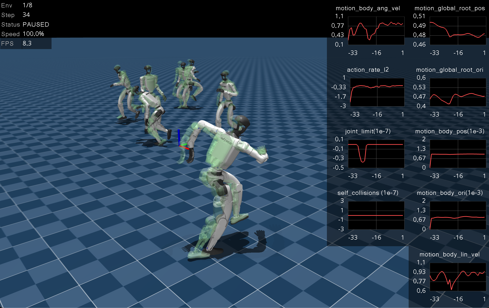
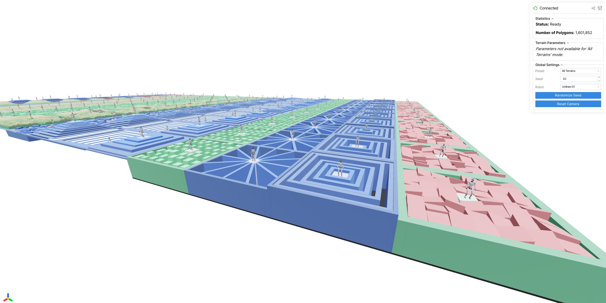

=========
Changelog
=========

Upcoming version (not yet released)
-----------------------------------

Added
^^^^^

- Added ``render_g1_motions`` (``mjlab.scripts.render_g1_motions``) to
  batch-render G1 motion ``.npz`` files under ``motions/`` to MP4 videos
  with MuJoCo offscreen rendering (chase camera, configurable size/fps,
  ground plane at z=0 for foot-clearance visualization).
- Added ``convert_chunwan`` (``mjlab.scripts.convert_chunwan``) to batch
  convert chunwan-flip G1 CSVs (SDK joint order, 36 cols, 30 fps) to mjlab
  ``.npz`` motions at 50 fps under ``motions/chunwan/``.
- Added ``motion_anchor_ang_vel_x`` reward
  (``motion_global_anchor_angular_velocity_x_error_exp``) to track
  world-frame x angular velocity of the motion anchor.
- Added ``convert_omnixtreme`` (``mjlab.scripts.convert_omnixtreme``) to
  split the long OmniXtreme G1 sequence (``motions/g1_motion_long.npz``,
  already in mjlab joint order) into per-motion clips at smoothed-energy
  pauses and write them under ``motions/omnixtreme/``.
- Added G1 training commands (train loop, checkpoint play, TensorBoard)
  to the README G1 tracking section.
- Added ``head_contact`` reward (``mdp.head_contact_cost``, weight -5.0):
  binary penalty when the G1 head sphere touches anything (e.g. ground),
  via a new ``head_contact`` ContactSensor on ``head_collision``. The term
  and sensor are removed for Go2 (no head).
- Enabled 0–3 physics-step actuator position delay for the G1 tracking
  task by default (``enable_actuator_delay=True``), matching the Go2
  randomization; auto-disabled in play mode.

Fixed
^^^^^

- Fixed ``convert_chunwan`` resample ratio (input/output was inverted),
  which made 30 fps→50 fps clips ~40% too short. Re-converted
  ``motions/chunwan/`` and re-rendered ``videos/g1_motions/chunwan/``.
- Fixed chunwan clips hovering above the ground (constant z offset from
  GMR retargeting, up to 0.17 m on 90_14/90_15): ``convert_chunwan`` now
  grounds the root trajectory via a robust contact-frame baseline (mean
  lowest-foot height over contact frames, falling back to the global min
  for airborne clips), aligned to the true sole height (0.0353 m below
  the ankle-roll body origin).
- Fixed G1 tracking startup crash: ``add_body_mass`` hardcoded Go2's
  ``trunk`` body in the base config; body names are now set per-robot
  (``trunk`` for Go2, ``torso_link`` for G1).
- Added a dedicated VS Code task for ``mjlab.scripts.convert_gc_go2`` with
  prompts for CSV path, FPS, device selection, optional line range, and video
  rendering.
- Added ``randomize_body_mass`` (calls ``set_const`` after mass changes) and
  tracking-task startup events for body-mass / PD-gain randomization. Go2
  tracking can toggle these via ``enable_body_mass_rand`` /
  ``enable_actuator_gains_rand``, and optionally wrap actuators with a 0–3
  physics-step delay via ``enable_actuator_delay``.
- Added ``play-go2-rand`` and ``PlayConfig.keep_randomization`` to play Go2
  tracking with training-time domain randomization (default 50 envs).
- Tracking saves now also export TorchScript ``policy.pt`` (for C++ deploy).
  Convert an existing checkpoint with ``export-tracking-pt``.

Version 1.1.1 (February 14, 2026)
---------------------------------

Added
^^^^^

- Added reward term visualization to the native viewer (toggle with ``P``).
- Added ``DifferentialIKAction`` for task-space control via damped
  least-squares IK. Supports weighted position/orientation tracking,
  soft joint-limit avoidance, and null-space posture regularization.
  Includes an interactive viser demo (``scripts/demos/differential_ik.py``).

Fixed
^^^^^

- Fixed ``play.py`` defaulting to the base rsl-rl ``OnPolicyRunner`` instead
  of ``MjlabOnPolicyRunner``, which caused a ``TypeError`` from an unexpected
  ``cnn_cfg`` keyword argument. Contribution by
  `@griffinaddison <https://github.com/griffinaddison>`_.

Changed
^^^^^^^

- Removed ``body_mass``, ``body_inertia``, ``body_pos``, and ``body_quat``
  from ``FIELD_SPECS`` in domain randomization. These fields have derived
  quantities that require ``set_const`` to recompute; without that call,
  randomizing them silently breaks physics.
- Replaced ``moviepy`` with ``mediapy`` for video recording. ``mediapy``
  handles cloud storage paths (GCS, S3) natively.

Version 1.1.0 (February 12, 2026)
---------------------------------

Added
^^^^^

- Added RGB and depth camera sensors and BVH-accelerated raycasting.
- Added ``MetricsManager`` for logging custom metrics during training.
- Added terrain visualizer. Contribution by
  `@mktk1117 <https://github.com/mktk1117>`_.

- Added many new terrains including ``HfDiscreteObstaclesTerrainCfg``,
  ``HfPerlinNoiseTerrainCfg``, ``BoxSteppingStonesTerrainCfg``,
  ``BoxNarrowBeamsTerrainCfg``, ``BoxRandomStairsTerrainCfg``, and
  more. Added flat patch sampling for heightfield terrains.
- Added site group visualization to the Viser viewer (Geoms and Sites
  tabs unified into a single Groups tab).
- Added ``env_ids`` parameter to ``Entity.write_ctrl_to_sim``.

Changed
^^^^^^^

- Upgraded ``rsl-rl-lib`` to 4.0.0 and replaced the custom ONNX
  exporter with rsl-rl's built-in ``as_onnx()``.
- ``sim.forward()`` is now called unconditionally after the decimation
  loop. See :ref:`faq-sim-forward` for details.
- Unnamed freejoints are now automatically named to prevent
  ``KeyError`` during entity init.

Fixed
^^^^^

- Fixed ``randomize_pd_gains`` crash with ``num_envs > 1``.
- Fixed ``ctrl_ids`` index error with multiple actuated entities.
  Reported by `@bwrooney82 <https://github.com/bwrooney82>`_.
- Fixed Viser viewer rendering textured robots as gray.
- Fixed Viser plane rendering ignoring MuJoCo size parameter.
- Fixed ``HfDiscreteObstaclesTerrainCfg`` spawn height.
- Fixed ``RaycastSensor`` visualization ignoring the all-envs toggle.
  Contribution by `@oxkitsune <https://github.com/oxkitsune>`_.

Version 1.0.0 (January 28, 2026)
--------------------------------

Initial release of mjlab.
